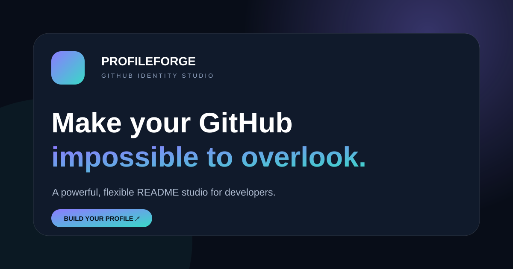

# ProfileForge — GitHub Profile Studio

A static, self-hostable GitHub profile README builder. It scans public GitHub metadata, lets you curate projects and professional details, composes a section-based README, and exports a ready-to-publish ZIP package.



## What is included

- **Live public profile scan:** profile metadata and up to 300 repositories through GitHub's public REST API.
- **Contribution calendar:** optional contribution data from a public calendar endpoint; gracefully degrades when unavailable.
- **16 profile templates:** career, open source, founder, student, research, creative and visual directions.
- **24 theme systems:** shared design tokens for the studio, preview and generated SVG assets.
- **12 composable sections:** reorder, remove and add profile sections without editing source code.
- **Profile editor:** headline, biography, location, company, website, email, social links, skills, experience, education and achievements.
- **Project curator:** select repositories, search and sort by stars, forks, update date or name.
- **Export:** README.md, theme-matched SVGs, editable JSON and an optional GitHub Actions workflow in one ZIP.
- **Local-first drafts:** autosaved to browser storage; import/export JSON for backup and migration.
- **No build step:** plain HTML, CSS and JavaScript; no framework or package installation.

## Run locally

Use a local static server (do not open `index.html` with `file://`, because browser fetch requests need an HTTP origin):

```bash
python -m http.server 8080
```

Then open `http://localhost:8080`.

## Deploy to GitHub Pages

1. Push the repository contents to the root of a GitHub repository.
2. Open **Settings → Pages**.
3. Select **Deploy from a branch**, choose `main` and `/ (root)`.
4. Save and open the Pages URL after GitHub finishes publishing.

See [SETUP.md](SETUP.md) for the Persian step-by-step guide.

## Data and privacy

The browser requests only public profile/repository metadata. No GitHub token is embedded. The current draft is saved in the browser's local storage. Share links carry only username, goal, template and theme; export JSON for the full draft.

The unauthenticated GitHub REST API has rate limits. If scanning fails with HTTP 403, wait for the reset window or use the local editor and import/export features. Never add a private token to a public Pages deployment.

## Optional contribution refresh

The included workflow is manual + weekly. It updates only `assets/<username>-heatmap.svg` and never rewrites `README.md`. For a profile README repository, copy the generated `scripts/refresh-profile.mjs` and `.github/workflows/refresh-profile-assets.yml` into that repository, then run the workflow once from the Actions tab.

## Project layout

```text
assets/                  Brand, placeholder and social preview SVGs
css/styles.css           Design system, responsive layout and README preview
data/config.js           Site settings and API limits
data/catalog.js          Themes, templates, sections and technology dictionary
js/app.js                State, API, editor, renderers and ZIP exporter
 scripts/                 Optional Node.js contribution asset generator
.github/workflows/       Optional scheduled asset refresh
```

## License

See [LICENSE](LICENSE).
